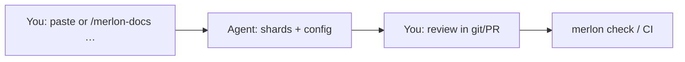
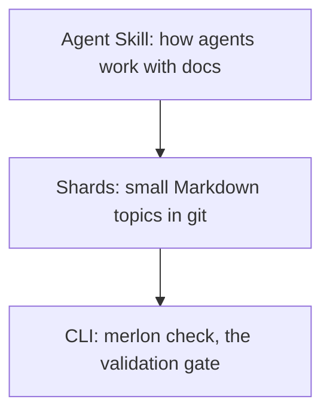

<!-- AUTO-GENERATED by Merlon Docs — edit shards, then run: merlon compile -->

# Merlon Docs — documentation system Agent Skill

<!-- merlon-shard: start docs/repo-readme/what-this-tool-is.md -->

## What this tool is

[](https://skills.sh/Merlon-Docs/merlon)

**Merlon Docs** is a **documentation system** delivered as an [Agent Skill](https://agentskills.io) plus a small compile/check toolchain. It is for **software projects** whose product documentation must stay **reviewable and structurally sound** as the code changes — especially for teams and agents who **operate the system for the long haul**, not for the engineer who keeps the whole scope in their head. **Accuracy** of what the docs say is a **human and agent** responsibility in review; **`merlon check`** validates links, compile output, and related gates, not whether the claims are true. If you are comparing it to other skills on [skills.sh](https://skills.sh) (for example LLM Wiki or aDNA-style vaults), [What kind of Agent Skill is this?](#what-kind-of-agent-skill-is-this) places it in that category and shows how to wire it through your project's `AGENTS.md`. If you are evaluating it for a team, [Vision and roadmap](docs/features/system/00-vision-and-roadmap.md) explains the problem it solves and the principles behind it.

Merlon Docs, formerly MDCP (MarkDown Context Protocol), is an open standard and an open-source project, MIT licensed.

Instead of putting every architecture note and spec into one file, Merlon Docs stores that intent as small, validated Markdown **shards** such as `docs/features/my-feature.md`, `docs/procedures/line-changeover.md`, `docs/equipment/press-manual.md` or `docs/training/onboarding-module.md`. The Agent Skill tells agents to read **one shard at a time** and to update the shards before they change what the shards describe. In CI, `merlon check` fails when a shard is orphaned or an internal link is broken. Discover and install via [skills.sh](https://skills.sh/Merlon-Docs/merlon). <!-- merlon-paths: illustrative -->

<!-- merlon-shard: end docs/repo-readme/what-this-tool-is.md -->

<!-- merlon-shard: start docs/repo-readme/kind-of-agent-skill.md -->

## What kind of Agent Skill is this?

<!-- merlon-paths: illustrative -->

On [skills.sh](https://skills.sh) you will find many skills that teach an agent a repeatable procedure. Merlon Docs belongs with **project knowledge and documentation guardrails** — the same neighborhood as skills such as **[LLM Wiki](https://github.com/alainbrown/skills/tree/main/skills/llm-wiki)** (bootstrap, ingest, query, and lint a compounding markdown wiki) and **[aDNA](https://adna.network/reference/specification/)**-style vaults (what / who / how layout, `AGENTS.md` in each area, and procedural skill files in the vault's how leg).

Those patterns optimize for **broad knowledge** or **whole-vault organization**. Merlon Docs optimizes for **software you ship from git**: small validated **shards**, a compile step, and **`merlon check`** in CI so docs stay reviewable and link-safe as the code changes.

### Comparison at a glance

| Pattern                             | What it is optimized for                                                                                 | Merlon Docs difference                                                                                                                                                                                      |
| ----------------------------------- | -------------------------------------------------------------------------------------------------------- | ----------------------------------------------------------------------------------------------------------------------------------------------------------------------------------------------------------- |
| **LLM Wiki**                        | A persistent wiki you ingest sources into and query across sessions                                      | Shards live **in your product repo** next to code; validation is structural (orphans, links, compile), not wiki lint alone                                                                                  |
| **aDNA vault**                      | Full project vault: missions, pipelines, skills, per-folder `AGENTS.md`                                  | **Documentation-system** skill + CLI; default [Code Repository Archetype](docs/features/system/extensions-and-archetypes.md#archetypes-battery-types) for `features/`, `developer/`, `client/`, `glossary/` |
| **Cursor rules / lone `AGENTS.md`** | Host-native hints                                                                                        | Product intent lives in **shards**, not only in host config; the skill enforces **update docs before you change what they describe**                                                                        |
| **Merlon Docs**                     | Long-lived **software projects** where humans and agents co-maintain specs, ADRs, runbooks, and API docs | Agent Skill + `merlon` CLI; installs from [skills.sh/Merlon-Docs/merlon](https://skills.sh/Merlon-Docs/merlon)                                                                                              |

Merlon Docs can **compile** into READMEs, monoliths, or downstream site generators. It is not a replacement for Docusaurus or MkDocs when you only need a public website with no agent discipline — see [Alternatives and adoption](docs/features/system/02-alternatives-and-adoption.md).

### Who it is for (and who can skip it)

Merlon Docs is for people who **operate or extend the software for the long haul**: teammates who onboard later, agents that were not in last week's chat, you six months from now.

It is **not** aimed at the engineer who keeps the entire project scope in their head and sees no documentation debt. That can work for a while; Merlon Docs is for **everyone else** who pays when that knowledge is missing — and for leads who want **guardrails** so agents do not ship code without updating the shards that describe it. The personas page names this reader explicitly: [Anti-persona: the engineer who keeps the system in their head](docs/features/personas-and-priority-tiers.md#audience-priority).

### Add it to your project (and wire `AGENTS.md`)

1. **Install the skill** and commit the copy so every teammate and agent shares the same discipline:

   ```bash
   npx skills add Merlon-Docs/merlon --skill merlon-docs
   ```

2. **Reference Merlon Docs in your project's `AGENTS.md`** (or `CLAUDE.md`, or your host's equivalent). That file is what agents read first; pointing at the skill turns documentation from optional advice into **project policy**. Example lines you can adapt:

   ```markdown
   ## Documentation

   This repository uses [Merlon Docs](https://github.com/Merlon-Docs/merlon). Shards under `docs/` are the source of truth; compiled READMEs are generated.

   - Install: `merlon-docs` skill (see `.agents/skills/merlon-docs` or your agent's skills directory).
   - For documentation work, invoke `/merlon-docs` before editing shards or product behavior.
   - After shard edits, run `merlon compile` and `merlon check` (or `pnpm docs:check` if wired in this repo). Compile builds the guides you review; check validates links and the docs tree — not whether the prose is factually correct.
   - Do not hand-edit files that contain `<!-- merlon-shard:` markers.
   ```

3. **Add the CLI to scripts or CI** when you are ready — [Get started](#get-started) Path B, or let Path A's bootstrap session wire it.

The skill does not replace `AGENTS.md`; it **works with** it. Host config says _that documentation discipline exists_; the skill says _how_ to shard, compile, check, and review.

### Where to go next

- [Get started](#get-started) — Path A (skill) and Path B (CLI)
- [Vision and roadmap](docs/features/system/00-vision-and-roadmap.md) — problem and principles
- [Merlon Docs 101](#merlon-docs-101) — habit and readiness checklist

<!-- merlon-shard: end docs/repo-readme/kind-of-agent-skill.md -->

<!-- merlon-shard: start docs/repo-readme/about.md -->

## Why use Merlon Docs?

Find the line that matches what you want from Merlon Docs:

- **Integrate Merlon Docs into repo scripts and CI:** `merlon check` is one gate for editors and CI.
- **Try Merlon Docs before mastering every CLI flag:** paste the bootstrap prompt from [Get started](#get-started), and the agent walks you through setup.
- **Own content, not the toolchain:** each topic is its own shard. When you or an agent reads only the shard for a task, the context contains one topic in place of the whole guide.
- **Evaluate or sponsor adoption:** judge fit from the vision and the benefit claims policy before anyone installs anything. [Evaluate before you adopt](#evaluate-before-you-adopt) links both pages.

<!-- merlon-shard: end docs/repo-readme/about.md -->

<!-- merlon-shard: start docs/repo-readme/get-started.md -->

## Get started

Merlon Docs has two ways in, and the right one depends on who edits your docs:

- **Path A, the Agent Skill:** an agent edits the docs in your repository, and the skill tells it when to update shards and when to compile and check them.
- **Path B, the CLI in scripts and CI:** people edit the shards, and the `merlon` command compiles and checks them in npm scripts and the pipeline.

A repository can take both paths. Path A's bootstrap session installs the CLI too, because agents run `merlon` commands, as [The Toolchain](#the-toolchain) explains.

### Evaluate before you adopt

If you are deciding whether a team should adopt Merlon Docs, read two pages before anyone installs it. [Vision and roadmap](docs/features/system/00-vision-and-roadmap.md) explains the problem Merlon Docs solves and the principles behind it. [Benefit claims and evidence](docs/features/system/benefit-claims-and-evidence.md) separates what the tool does from outcomes that depend on how a team works, and says which claims have evidence behind them. Then try Path A or Path B in one repository to see the workflow on your own docs.

### Path A: install the Agent Skill

Install the Merlon Docs Agent Skill into your repository with the [`skills` CLI](https://www.skills.sh/docs/cli), which [skills.sh](https://skills.sh) also uses:

```bash
npx skills add Merlon-Docs/merlon --skill merlon-docs
```

_This copies the skill into your agent's skills directory. The [`skills` CLI](https://www.skills.sh/docs/cli) picks the directory from `--agent` or by detecting the agent, and its docs list the path for each agent. Commit the copy to git so every teammate and agent shares the same documentation discipline._

Then **reference Merlon Docs in your project's `AGENTS.md`** (or host equivalent). A short Documentation section that names the skill, `/merlon-docs`, and `merlon check` turns documentation into shared policy — see [What kind of Agent Skill is this?](#add-it-to-your-project-and-wire-agentsmd) for example lines.

Then start a bootstrap session:

```text
/merlon-docs help me get started
```

The bootstrap session starts by asking for the feature, the reader persona and your experience level. Then it helps wire config, guide layout, and validation. After bootstrap, it offers an optional **first feature** walk through design → feature → UX → doc-only (recommended example or your own), which you take or skip. Once the pipeline exists, the skill tells agents to read the shard for a task, compile the docs and validate references before they change the system.

### Path B: run the CLI in scripts and CI

Install [`@merlon-docs/merlon-docs-cli`](packages/merlon-docs-cli/README.md) as a dev dependency and follow its [Quick start](packages/merlon-docs-cli/README.md#quick-start), which starts from a config for two guides and ends with the `docs:compile` and `docs:check` scripts that CI runs.

<!-- merlon-shard: end docs/repo-readme/get-started.md -->

<!-- merlon-shard: start docs/repo-readme/merlon-docs-101.md -->

## Merlon Docs 101

[Merlon Docs](docs/glossary/merlon-docs.md) is a **human + AI documentation habit** for technical work: you and your agent keep durable intent in small Markdown files in git, instead of only in chat history.

### The problem

Agents forget. Chat threads disappear. Giant READMEs and dump files overwhelm both humans and model context. Next week's session cannot reliably reuse yesterday's decisions.

### How you work together

1. **You** decide what must stay true (product intent, constraints, glossary).
2. **The agent** drafts or updates small **[shards](docs/glossary/shard.md)** (one topic per file) _before_ coding.
3. **You** review those shards in pull requests (PRs) — you do not need to be a Markdown expert on day one.
4. **`merlon compile`** builds the guides you review (for example one README or monolith per guide). **`merlon check`** (locally or in CI) proves the documentation tree still compiles and that links and configured lint gates pass — it does **not** judge whether the words are correct; you and the agent do that in review.

#### Prompt loop



**In a chat-only tool with no access to your repository:** don't install the toolchain yet. Keep notes in your project folder if you have one, or wait until you use an agent that can edit a git repository. Read [Overview](docs/features/overview.md) and [Vision and roadmap](docs/features/system/00-vision-and-roadmap.md) first.

Otherwise take Path A or Path B in [Get started](#get-started).

### Are you ready?

| Scenario                                          | Ready?    |
| ------------------------------------------------- | --------- |
| Git repo + an agent that can edit files           | Start now |
| Docs or decisions already sprawling (or about to) | Start now |
| Willing to review doc changes, not only code      | Start now |
| Chat-only coding with no project folder           | Wait      |
| One-off toy you will not reopen                   | Wait      |
| No interest in durable docs beyond chat           | Wait      |

You feel the benefit on the **second session** — when prior decisions are still findable — not on the first install.

### What's in the box



- **[Agent Skill](https://agentskills.io)** ([definition](docs/glossary/agent-skills.md)): instructions your agent follows (`/merlon-docs`, which picks a workflow for each task).
- **[Shards](docs/glossary/shard.md)**: source of truth. Compiled READMEs are generated, so do not hand-edit them.
- **CLI**: `merlon compile` builds the guides and [`merlon check`](docs/glossary/check.md) validates the docs system as it grows. Both run on the Core library.

[The Toolchain](#the-toolchain) lists the three surfaces and their installs, and [Overview](docs/features/overview.md) explains the deeper model.

<!-- merlon-shard: end docs/repo-readme/merlon-docs-101.md -->

<!-- merlon-shard: start docs/repo-readme/the-toolchain.md -->

## The Toolchain

Merlon Docs has **three separate surfaces**. Each one is its own install with its own docs.

- **Agent Skill**: how agents maintain shards (`/merlon-docs` and its workflows). This README is its documentation, [Get started](#get-started) shows how to install it, and the [skill catalog](docs/skills.md) lists its workflows.
- **CLI**: shell commands only. Install and usage: [`@merlon-docs/merlon-docs-cli`](packages/merlon-docs-cli/README.md).
- **Core**: programmatic API only. Install and usage: [`@merlon-docs/merlon-docs-core`](packages/merlon-docs-core/README.md).

Presets are optional: [`@merlon-docs/merlon-docs-presets`](packages/merlon-docs-presets/README.md) holds starter markdownlint configs and the `MerlonDocs` Vale style for the CLI's lint and prose commands, and its README says how to install it alongside the CLI.

The skill tells agents _when_ and _how_ to use documentation; the CLI and core **execute** compile and validation. Agents still need `@merlon-docs/merlon-docs-cli` (or equivalent scripts) in the repo for those commands to run.

<!-- merlon-shard: end docs/repo-readme/the-toolchain.md -->

<!-- merlon-shard: start docs/repo-readme/versions-and-feedback.md -->

## Versions and feedback

Packages and skills version independently, and the [pre-1.0 policy](docs/developer/versioning-and-releases.md#pre-10-policy-0xy) says what can change before each one reaches 1.0.0.

### Get involved

Open a [GitHub issue](https://github.com/Merlon-Docs/merlon/issues) for feedback and bugs. To share how your team uses Merlon Docs, open an issue from the [adoption-story template](https://github.com/Merlon-Docs/merlon/issues/new?template=adoption-story.yml).

<!-- merlon-shard: end docs/repo-readme/versions-and-feedback.md -->

<!-- merlon-shard: start docs/repo-readme/learn-more.md -->

## Learn More

Go deeper by goal:

- **Integrate Merlon Docs into repo scripts and CI:** the [CLI consumer guide](packages/merlon-docs-cli/README.md) for `@merlon-docs/merlon-docs-cli`, and the [Core API guide](packages/merlon-docs-core/README.md) for `@merlon-docs/merlon-docs-core` when a script calls the library.
- **Try Merlon Docs before mastering every CLI flag:** the [getting-started workflow](docs/features/system/workflows/getting-started.md) that the bootstrap prompt starts. The [Agent Skill](docs/features/agent-skill.md) spec and the skill's page on [skills.sh](https://skills.sh/Merlon-Docs/merlon) describe the skill itself.
- **Own content, not the toolchain:** the [Overview](docs/features/overview.md) of how Merlon Docs fits together, and the [usage model](docs/features/system/usage-model.md) for how people and agents read shards.
- **Evaluate or sponsor adoption:** the [vision and roadmap](docs/features/system/00-vision-and-roadmap.md), and the [benefit claims policy](docs/features/system/benefit-claims-and-evidence.md).

The [docs site](https://merlon-docs.github.io/merlon/) publishes the CLI guide, the concepts, the library API and the glossary as web pages.

<!-- merlon-shard: end docs/repo-readme/learn-more.md -->

<!-- merlon-shard: start docs/repo-readme/this-repository.md -->

## This repository

Contributors and maintainers working on the **Merlon Docs monorepo** — not consumers adopting Merlon Docs in another repo.

Set up a checkout with [Local setup](docs/developer/local-setup.md). [DEVELOPERS.md](DEVELOPERS.md) is the full contributor guide, and it explains [how these docs are sharded](docs/developer/docs-dogfooding.md). This README follows the [publish landing style](docs/features/personas-and-priority-tiers.md#publish-landing-style).

This project follows the [Contributor Covenant Code of Conduct](CODE_OF_CONDUCT.md).

To work on the Agent Skill itself, start with [Agent Skill development](docs/developer/agent-skill.md).

### Acknowledgments

- Denali Lumma, for early review and feedback
- Lisa Crispin (She/Her)

### License

MIT

<!-- merlon-shard: end docs/repo-readme/this-repository.md -->
