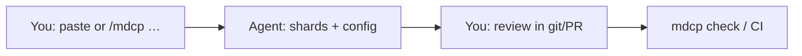
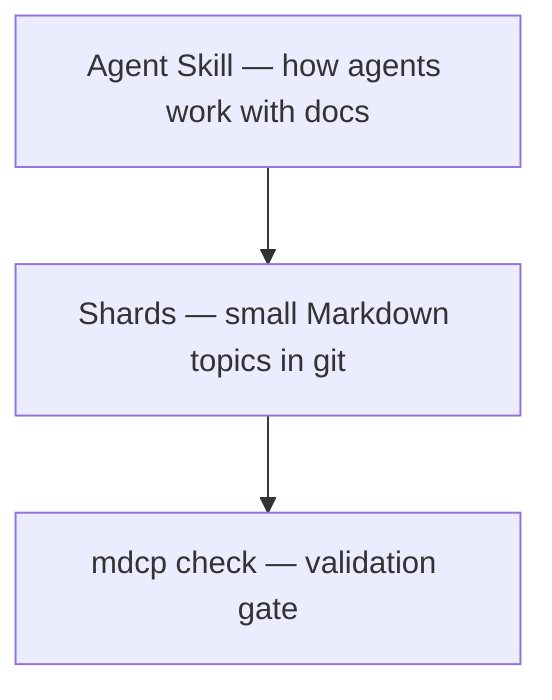

<!-- AUTO-GENERATED by mdcp — edit shards, then run: mdcp compile -->

# MDCP — documentation system Agent Skill

<!-- mdcp-shard: start docs/repo-readme/what-this-tool-is.md -->

## What this tool is

[](https://skills.sh/betsalel-williamson/mdcp)

**MarkDown Context Protocol (MDCP)** is a **documentation system** delivered as an [Agent Skill](https://agentskills.io) plus a small compile/check toolchain. It is for people whose docs grow as product ideas keep arriving and who want each topic in a small file that a check validates. If you are evaluating it for a team, [Vision and roadmap](docs/features/protocol/00-vision-and-roadmap.md) explains the problem it solves and the principles behind it.

Instead of dumping every mind map, architecture note, and spec into one file that overwhelms both humans and LLM context windows, MDCP stores that intent as small, validated Markdown **shards** such as `docs/features/my-feature.md`, `docs/procedures/line-changeover.md`, `docs/equipment/press-manual.md` or `docs/training/onboarding-module.md`. The Agent Skill tells agents to read **one shard at a time** and to update the shards before they change what the shards describe. In CI, `mdcp check` fails when a shard is orphaned or an internal link is broken. Discover and install via [skills.sh](https://skills.sh/betsalel-williamson/mdcp). <!-- mdcp-paths: illustrative -->

<!-- mdcp-shard: end docs/repo-readme/what-this-tool-is.md -->

<!-- mdcp-shard: start docs/repo-readme/get-started.md -->

## Get started

Install MDCP when you want a **documentation system** your agents will actually follow — sharded Markdown, compile/check in CI, and less effort keeping docs honest as ideas arrive. Use the [`skills` CLI](https://www.skills.sh/docs/cli) (same path as [skills.sh](https://skills.sh)).

### Evaluate before you adopt

If you are deciding whether a team should adopt MDCP, read two pages before anyone installs it. [Vision and roadmap](docs/features/protocol/00-vision-and-roadmap.md) explains the problem MDCP solves and the principles behind it. [Benefit claims and evidence](docs/features/protocol/benefit-claims-and-evidence.md) separates what the tool does from outcomes that depend on how a team works, and says which claims have evidence behind them. Then run the Quick Start below in one repository to see the workflow on your own docs.

### Quick Start

Install the mdcp Agent Skill into your repository:

```bash
npx skills add betsalel-williamson/mdcp --skill mdcp
```

_This copies the skill into your agent's skills directory. The [`skills` CLI](https://www.skills.sh/docs/cli) picks the directory from `--agent` or by detecting the agent, and its docs list the path for each agent. Commit the copy to git so every teammate and agent shares the same documentation discipline._

Then start a bootstrap session:

```text
/mdcp help me get started
```

The bootstrap session starts by asking for the feature, the reader persona and your experience level. Then it helps wire config, guide layout, and validation. After bootstrap, it offers an optional **first feature** walk through design → feature → UX → doc-only (recommended example or your own), which you take or skip. Once the pipeline exists, the skill tells agents to read the shard for a task, compile the docs and validate references before they change the system.

<!-- mdcp-shard: end docs/repo-readme/get-started.md -->

<!-- mdcp-shard: start docs/repo-readme/about.md -->

## Why use MDCP?

- **Built for documentation-system thinkers:** Puts durable intent (specs, design notes, glossaries) in the repo where it compounds — not only in chat history or slide decks.
- **Lower maintenance as ideas keep coming:** One topic per shard means new features extend the docs tree instead of bloating a single file you no longer trust.
- **Docs-as-code for agents:** agents update shards before they change code, so “what we meant” stays reviewable in git alongside the change.
- **Smaller, safer context loads:** People and LLMs read the section that matches the task — not the whole guide every turn.
- **Validation gate:** `mdcp check` keeps cross-links and refs trustworthy in CI when the docs system grows.
- **Portable skill:** works in any host that supports [Agent Skills](https://agentskills.io).

<!-- mdcp-shard: end docs/repo-readme/about.md -->

<!-- mdcp-shard: start docs/repo-readme/mdcp-101.md -->

## MDCP 101

[MDCP](docs/glossary/mdcp.md) is a **human + AI documentation habit** for technical work: you and your agent keep durable intent in small Markdown files in git, instead of only in chat history.

### The problem

Agents forget. Chat threads disappear. Giant READMEs and dump files overwhelm both humans and model context. Next week's session cannot reliably reuse yesterday's decisions.

### How you work together

1. **You** decide what must stay true (product intent, constraints, glossary).
2. **The agent** drafts or updates small **[shards](docs/glossary/shard.md)** (one topic per file) _before_ coding.
3. **You** review those shards in pull requests (PRs) — you do not need to be a Markdown expert on day one.
4. **`mdcp check`** (locally or in CI) proves links and compile still work.

#### Prompt loop



**In an [Agent Skills](https://agentskills.io) host:** install the skill, then type or paste the bootstrap prompt that [Get started](#get-started) shows.

**In a chat-only tool with no access to your repository:** don't install the toolchain yet. Keep notes in your project folder if you have one, or wait until you use an agent that can edit a git repository. Read [Overview](docs/features/overview.md) and [Vision and roadmap](docs/features/protocol/00-vision-and-roadmap.md) first.

**Automation / CI:** the [Agent Skill](docs/features/agent-skill.md) tells agents _when_ to touch docs, and the [CLI](packages/mdcp-cli/README.md) runs `compile` and `check` in scripts and pipelines. [The Toolchain](#the-toolchain) covers both.

### Are you ready?

| Scenario                                          | Ready?    |
| ------------------------------------------------- | --------- |
| Git repo + an agent that can edit files           | Start now |
| Docs or decisions already sprawling (or about to) | Start now |
| Willing to review doc changes, not only code      | Start now |
| Chat-only coding with no project folder           | Wait      |
| One-off toy you will not reopen                   | Wait      |
| No interest in durable docs beyond chat           | Wait      |

You feel the benefit on the **second session** — when prior decisions are still findable — not on the first install.

### What's in the box



- **[Skill](https://agentskills.io)** ([definition](docs/glossary/agent-skills.md)): instructions your agent follows (`/mdcp`, which picks a workflow for each task).
- **[Shards](docs/glossary/shard.md)**: source of truth. Compiled READMEs are generated, so do not hand-edit them.
- **[Check](docs/glossary/check.md)**: validates the docs system as it grows.

[Overview](docs/features/overview.md) explains the deeper model.

<!-- mdcp-shard: end docs/repo-readme/mdcp-101.md -->

<!-- mdcp-shard: start docs/repo-readme/the-toolchain.md -->

## The Toolchain

MDCP has **three separate surfaces**. Each has its own docs — do not treat them as one install or one README.

- **Agent Skill**: how agents maintain shards (`/mdcp` and its workflows). This README is its documentation, and [Get started](#get-started) shows how to install it.
- **CLI**: shell commands only. Install and usage: [`@bwilliamson/mdcp-cli`](packages/mdcp-cli/README.md).
- **Core**: programmatic API only. Install and usage: [`@bwilliamson/mdcp-core`](packages/mdcp-core/README.md).

The skill tells agents _when_ and _how_ to use documentation; the CLI and core **execute** compile and validation. Agents still need `@bwilliamson/mdcp-cli` (or equivalent scripts) in the repo for those commands to run.

<!-- mdcp-shard: end docs/repo-readme/the-toolchain.md -->

<!-- mdcp-shard: start docs/repo-readme/project-status.md -->

## Project status

Packages and skills version independently, and the [pre-1.0 policy](docs/developer/versioning-and-releases.md#pre-10-policy-0xy) says what can change before each one reaches 1.0.0.

### Get involved

Open a [GitHub issue](https://github.com/betsalel-williamson/mdcp/issues) for feedback and bugs. To share how your team uses MDCP, open an issue from the [adoption-story template](https://github.com/betsalel-williamson/mdcp/issues/new?template=adoption-story.yml).

<!-- mdcp-shard: end docs/repo-readme/project-status.md -->

<!-- mdcp-shard: start docs/repo-readme/learn-more.md -->

## Learn More

- [Overview — how MDCP fits together](docs/features/overview.md)
- [skills.sh — MDCP skills](https://skills.sh/betsalel-williamson/mdcp)
- [Vision and roadmap](docs/features/protocol/00-vision-and-roadmap.md)
- [Agent Skill](docs/features/agent-skill.md)
- [CLI consumer guide](packages/mdcp-cli/README.md) for `@bwilliamson/mdcp-cli`, which is separate from the skill
- [Core API guide](packages/mdcp-core/README.md) for `@bwilliamson/mdcp-core`

<!-- mdcp-shard: end docs/repo-readme/learn-more.md -->

<!-- mdcp-shard: start docs/repo-readme/this-repository.md -->

## This repository

Contributors and maintainers working on the **mdcp monorepo** — not consumers adopting mdcp in another repo.

Set up a checkout with [Local setup](docs/developer/local-setup.md). [DEVELOPERS.md](DEVELOPERS.md) is the full contributor guide, and it explains [how these docs are sharded](docs/developer/docs-dogfooding.md). This README follows the [publish landing style](docs/features/personas-and-priority-tiers.md#publish-landing-style).

This project follows the [Contributor Covenant Code of Conduct](CODE_OF_CONDUCT.md).

To work on the Agent Skill itself, start with [Agent Skill development](docs/developer/agent-skill.md).

### Acknowledgments

- [Denali Lumma (@dlumma)](https://github.com/dlumma) — early review and feedback
- [Lisa Crispin](https://lisacrispin.com) (She/Her) — [LinkedIn](https://www.linkedin.com/in/lisacrispin/)

### License

MIT

<!-- mdcp-shard: end docs/repo-readme/this-repository.md -->
