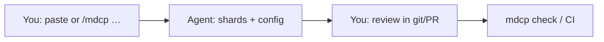
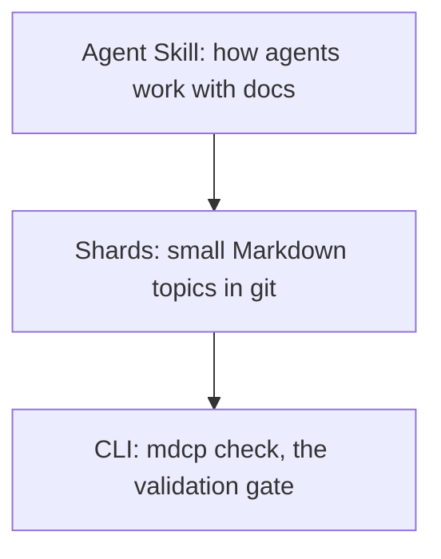

# MDCP 101

[MDCP](../glossary/mdcp.md) is a **human + AI documentation habit** for technical work: you and your agent keep durable intent in small Markdown files in git, instead of only in chat history.

## The problem

Agents forget. Chat threads disappear. Giant READMEs and dump files overwhelm both humans and model context. Next week's session cannot reliably reuse yesterday's decisions.

## How you work together

1. **You** decide what must stay true (product intent, constraints, glossary).
2. **The agent** drafts or updates small **[shards](../glossary/shard.md)** (one topic per file) _before_ coding.
3. **You** review those shards in pull requests (PRs) — you do not need to be a Markdown expert on day one.
4. **`mdcp check`** (locally or in CI) proves links and compile still work.

### Prompt loop

**In a chat-only tool with no access to your repository:** don't install the toolchain yet. Keep notes in your project folder if you have one, or wait until you use an agent that can edit a git repository. Read [Overview](../features/overview.md) and [Vision and roadmap](../features/protocol/00-vision-and-roadmap.md) first.

Otherwise take Path A or Path B in [Get started](./get-started.md).

## Are you ready?

| Scenario                                          | Ready?    |
| ------------------------------------------------- | --------- |
| Git repo + an agent that can edit files           | Start now |
| Docs or decisions already sprawling (or about to) | Start now |
| Willing to review doc changes, not only code      | Start now |
| Chat-only coding with no project folder           | Wait      |
| One-off toy you will not reopen                   | Wait      |
| No interest in durable docs beyond chat           | Wait      |

You feel the benefit on the **second session** — when prior decisions are still findable — not on the first install.

## What's in the box

- **[Agent Skill](https://agentskills.io)** ([definition](../glossary/agent-skills.md)): instructions your agent follows (`/mdcp`, which picks a workflow for each task).
- **[Shards](../glossary/shard.md)**: source of truth. Compiled READMEs are generated, so do not hand-edit them.
- **CLI**: `mdcp compile` builds the guides and [`mdcp check`](../glossary/check.md) validates the docs system as it grows. Both run on the Core library.

[The Toolchain](./the-toolchain.md) lists the three surfaces and their installs, and [Overview](../features/overview.md) explains the deeper model.
